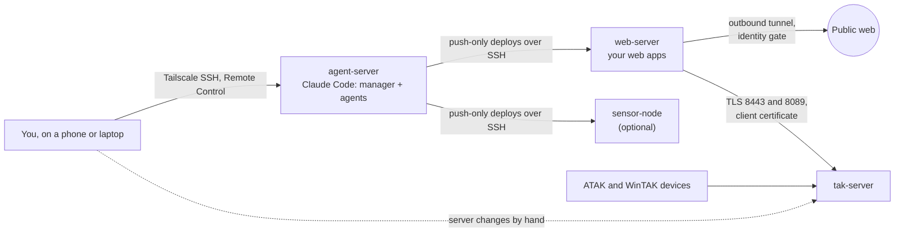

# agent-infrastructure

A team of ten Claude Code agents on a headless Linux box, driven from a phone
or laptop: a manager that reviews and routes every request, eight domain
agents, and a cheaper builder model that writes code to a settled design.
This is the setup Bracken Systems runs day to day, published so you can copy
the parts that fit. Bracken builds drone mission-planning and flight-log
tools, airframes and RF sensing, with TAK integration, which is why the
domain agents cover ArduPilot, RF and TAK; yours will cover your own work. The rule set and agent files in [`setup/`](setup/) are
the live ones.

**What is different about it**

- **Review before brief.** Every request is checked against the source, the
  README and the measured numbers, and answered approve or push back,
  before any agent is briefed.
- **Routing is where the cost is.** Design stays with the expensive domain
  agents; code to a settled design goes to a Sonnet `builder` with a fixed
  file list. Two weeks of usage figures below.
- **No check passes on an agent's word.** The builder reports pass and fail
  counts; whoever briefed it reruns the checks before reporting anything.
- **Instructions versus enforcement, stated.** A table says which rules the
  harness or the network enforces and which hold only as well as the model
  follows them.
- **Every rule has a failure behind it.** [Fifteen incidents](docs/incidents.md)
  and the rule each one produced; one has none yet.

**New to this? [Set it up in the cloud](https://github.com/brackenjoe/agent-infrastructure/blob/v4/docs/cloud.md).**
No server: make a GitHub account, point the AI you already use at that
page, and it walks you through Claude Code in the cloud with a manager, a
builder and a short rule set, or through [Codex in the cloud](https://github.com/brackenjoe/agent-infrastructure/blob/v4/docs/codex-cloud.md)
with project instructions in AGENTS.md.

**Read in this order:** the diagram and agents below, then
[How a task flows](#how-a-task-flows) and
[what enforces which rule](#the-rules-and-what-enforces-them). To try it,
[Start small](#start-small). The rest is in [`docs/`](docs/).

## What you end up with

- **agent-server.** One headless box holds the repo, Claude Code and every
  agent. You talk to it from a phone or laptop. Nothing reaches into it except you.
- **web-server.** Your apps listen on localhost and are published through an
  outbound tunnel with an identity gate in front. The agents deploy to it by
  pushing over SSH; it holds no key back.
- **tak-server.** Receives data packages and Cursor on Target from the web
  server, authenticated by a client certificate. The agent server has no
  network path to it; changes there are made by you, from steps an agent
  writes. The web server does have a path and holds the certificate, so
  what keeps an agent off TAK through the web server is a rule, not the
  network.
- **sensor-node.** Optional. Any field box the agents deploy to the same way
  as the web server.

Every machine sits on one Tailscale network with tag-based access rules, and
those rules, not the agents' good behaviour, decide what can reach what.

## The agents

| Agent | Model | Software it works with | Used for |
|---|---|---|---|
| `manager` | the session's model | Claude Code's agent and worktree tools | The front door: reviews each request, routes it to the agent that fits, or does a few minutes' work itself |
| `builder` | Sonnet, cannot spawn agents | whatever the brief names: Python, JavaScript, shell, the project's tests | Code to a settled design, one deliverable per brief, inside a fixed list of files |
| `stl-creator` | Opus | OpenSCAD, CadQuery, `xvfb-run` for PNG previews | Making STL files: a description, photo or measurements in, a parametric model, STL and preview out |
| `airframe` | Opus | manufacturer thrust tables, weight and endurance budgets | Choosing frames, motors, props and packs; thrust margin and hover time; reading a first hover log |
| `ardupilot-programmer` | Opus | ArduPilot, Lua scripting, SITL, MAVProxy and MAVLink, ExpressLRS | Anything that runs on or talks to a flight controller: parameter sets, upgrade diffs, onboard scripts |
| `rf-sensing` | Opus | HackRF (`hackrf_sweep`, receive only), the sensor's own service and page | Receive-only RF detection and direction finding on a sensor node |
| `tak-sme` | Opus | TAK Server, Cursor on Target, data packages, ATAK and WinTAK | Server users and certificates, what any feed sends, anything that must show on a device |
| `web-apps` | Opus | FastAPI, Pyodide, Playwright browser checks | Building and deploying the web apps (here, a mission planner and a flight log analyser) |
| `box-keeper` | Opus | Ubuntu, systemd, tmux, sshd, Tailscale, LVM, Clonezilla | The Linux machines at the OS level: services, access, updates, backups, config captures |
| `promo` | Opus | Playwright recording, ffmpeg, SITL flights | Clips, stills and caption cards for the apps; it never posts |

`manager` and `builder` are general and worth keeping as they are. The
other eight are this setup's domains: replace them with your own, one per
area that keeps coming back.

The manager runs at the session's model (`model: inherit`). The costly
failure here was a routing error at that model, fixed by a rule rather than
a model change (see below). A cheaper manager has not been tried.

## How a task flows

1. You send a task from your phone or laptop. The manager reviews it against the
   source, the README and the measured numbers, and answers approve or push
   back before anything is briefed. A choice that is yours waits for you.
2. The manager routes it: to a domain agent for design, deploys and live
   hardware; to `builder` for code to a settled design, with the files it
   may edit, the data shape, the pattern to copy and the checks to run; or
   it does a few minutes' work itself.
3. The builder reports every check with its pass and fail counts, and a
   check that did not run as not run. The agent that briefed it reruns
   those checks itself before reporting anything as passed.
4. The job finishes with its README updated, the repo check clean, the
   worktree merged and removed, and a push to your private remote. The
   report names each builder brief, or why there was none.

Routing is where the cost is. Over two weeks here, four builds briefed to
the expensive domain agents instead of the builder took about a quarter of
all subagent usage (an estimate, weighting turns by model); the builder,
doing most of the code, took 5.5%.

## The rules, and what enforces them

Most rules are instructions the model is trusted to follow. These are
enforced by something other than the model. The Claude Code rows were
checked against versions 2.1.289 and 2.1.302 and the
[permissions](https://code.claude.com/docs/en/permissions) and
[permission modes](https://code.claude.com/docs/en/permission-modes) docs,
read 2026-10-17.

| Rule | Enforced by | Limits |
|---|---|---|
| Creating or editing an agent file asks you first | the ask rule `Edit(**/.claude/agents/**)` in `.claude/settings.json` | Holds in every mode; see below the table. Covers Claude Code's file tools, not a script that writes the file itself. Spawning an agent never prompts: `Agent(...)` allow rules do nothing, and auto mode drops them |
| The builder cannot spawn agents | `disallowedTools: Agent` in its frontmatter | |
| The agent server cannot reach the TAK server | Tailscale access rules | The web server can, and agents deploy to it with sudo; that path is closed only by the stop rule |
| Deploy targets hold no key back to the agent server | SSH: no key installed on the targets | |
| Repo layout, index, links and stale worktrees | `tools/check-repo.sh` | only when run |
| No addresses, network names, private terms or credentials in a public push | `tools/public-scan.sh` | on every pull request here (public patterns only) and when run; does not replace reading the diff |

**Why the agent-file rule exists when Claude Code already protects
`.claude/`.** Without it, that built-in protection prompts in manual and
acceptEdits (with an option to allow the whole folder for the session),
leaves the write to the classifier in auto mode, denies it in dontAsk and
allows it in bypassPermissions
([permission modes](https://code.claude.com/docs/en/permission-modes),
Protected paths). Measured here on 2.1.289, headless with no rules, it
refused agent files both at the root and inside a git worktree under
`.claude/worktrees/`. The ask rule prompts in every mode, so auto and
bypass sessions ask too; in a `-p` run with nobody to answer, it is
denied. Keep the `**/` prefix: `Edit(.claude/agents/**)` matches only
where the session starts and let a worktree copy through in bypass mode.
The docs agree: a one-folder pattern such as `Edit(src/**)` matches at any
depth as a deny or ask rule, but a two-folder pattern is anchored where
the session starts (permissions, read 2026-10-17).
`tools/check-permissions.sh` repeats the bypass case on your version.

Cloud sessions pre-approve file edits in every mode, and the Protected
paths section names no cloud exception (permission modes, read
2026-10-17). Whether a cloud session still prompts on `.claude/` is not
yet measured, so keep the ask rule. A cloud session with several
repositories reads no permission rules from any of them, so neither the
ask rule nor deny rules apply there (settings, Settings in cloud
sessions, read 2026-10-17).

Everything else (review before brief, verify by exercising, stop before
credentials or the network's entry points, approval for every public push)
lives in `setup/CLAUDE.md` and the agent files, and holds only as well as
the model follows it.

## Start small

You do not need the servers, Tailscale or TAK to use the pattern. On any
machine with Claude Code and a git repo:

1. Copy [`starter/`](starter/) into your repo: its `CLAUDE.md` at the root
   and its `.claude/` beside it. It is the core with no domains in it: a
   manager, a builder, a short rule set with the Delegating section, and
   the settings below. Fill in the rule set's "This project" section.
2. Its `.claude/settings.json` is `{"agent": "manager", "permissions":
   {"ask": ["Edit(**/.claude/agents/**)"]}}`. The `agent` setting makes
   `manager.md` the main session: its body replaces Claude Code's default
   system prompt, while `CLAUDE.md` still loads.
3. If several sessions share one checkout, add the worktree rule from
   [Install the agents](#install-the-agents), step 6. The starter is what
   the cloud setup installs, and it leaves the rule out: in an
   Anthropic-hosted cloud environment each session runs in its own VM,
   which clones the repository
   ([Use Claude Code in the cloud](https://code.claude.com/docs/en/claude-code-on-the-web),
   read 2026-10-16).
4. Ask for something with a design step and a code step, and read the
   brief the manager writes. [`examples/brief-and-report.md`](examples/brief-and-report.md)
   is what a good one looks like.

`setup/` is the full live set, with this setup's domains and worked
examples in it. Add a domain agent when an area keeps coming back and has
traps a new session would re-learn. Add the machines when you want it
running without you at the keyboard.

## Install the agents

1. **Copy the rule set.** Put `setup/CLAUDE.md` at your repo root and
   `setup/.claude/` at `.claude/`. Claude Code reads `CLAUDE.md` in every
   session and the files in `.claude/agents/` as the agents you can spawn.
2. **Rewrite `CLAUDE.md` for your machine.** Keep its sections: what the
   machine is, where things live and which file to read for what,
   worktrees, scope, delegating, deliverables, when to act and when to
   stop, pushing. Replace the specifics. Keep it short: it is loaded into
   every session, so every line costs tokens on every turn.
3. **Keep `manager.md` and `builder.md`; rewrite the domain agents.** The
   manager routes by matching a task to the agents' `description` lines, so
   each description must say when to use that agent, not what it knows. Each
   domain agent points at its project's README instead of restating it, and
   ends with a "What the builder may not have" section naming the judgment
   that stays with it (design, deploys, live hardware, any claim about a
   measurement).
4. **Set the builder's limits in its frontmatter.** `model: sonnet` makes it
   the cheaper model; `disallowedTools: Agent` means it cannot spawn agents.
   Its body tells it to edit only the files its brief lists and never to
   commit, push or touch a live host; those are instructions, not
   permissions.
5. **Set the permissions in `.claude/settings.json`.** `"agent": "manager"`
   makes the manager the session default, replacing the default system
   prompt with its body. `Edit(**/.claude/agents/**)` under `ask` means no
   session creates or rewrites an agent without you seeing it. Spawning
   needs no rule: it never prompts. Put destructive connector tools under
   `deny`, under every name they take: `mcp__claude_ai_<server>__<tool>`
   where Claude Code fetches the connector itself (permissions, MCP, read
   2026-10-17), and `mcp__<server>__<tool>` in a cloud session with one
   repository, as seen here on 2026-10-17.
6. **Give each job its own worktree.** Several sessions share one checkout,
   and one session's `git stash` once took another's live edits. Put
   worktrees under `.claude/worktrees/` and add `**/.claude/worktrees/` to
   `.git/info/exclude`. Do not symlink a virtualenv or data directory into a
   worktree: a symlink is not matched by a directory ignore rule, gets
   committed, and checked out over the real directory it deletes it. Run the
   main checkout's interpreter by absolute path instead.
7. **Check what a script can check.** Adapt `tools/check-repo.sh` to your
   layout and make "the check passes" part of finishing a job. Run
   `tools/check-permissions.sh` after each Claude Code update: in a
   throwaway repo, it checks that the agent-file ask rule still stops an
   edit at the root and in a worktree copy. Before any push to a public
   remote, run `tools/public-scan.sh <dir>`, have an agent with none of the
   drafting context review new prose read-only, and read the diff anyway.

## The full build

| Doc | Covers |
|---|---|
| [Set it up in the cloud](docs/cloud.md) | the no-server path: an AI walks a newcomer through it, with [Claude Code](docs/claude-code-cloud.md) or [Codex](docs/codex-cloud.md) |
| [The agent server](docs/agent-server.md) | Ubuntu on LVM, Remote Control at boot, config capture, imaging, what broke |
| [Software on the agent server](docs/software.md) | what each agent uses, where it came from, and what stays off a headless box |
| [Network and access](docs/network.md) | Tailscale grants, one-way SSH deploy keys |
| [The web server](docs/web-server.md) | loopback apps behind Cloudflare Tunnel and Access, ufw, deploy by push, the stop rule |
| [Incidents](docs/incidents.md) | fifteen failures in six weeks, how each was caught, and the rule it produced, if any |
| [TAK Server integration](docs/tak-integration.md) | mission packages and CoT to a TAK Server over mutual TLS, failing closed, testing without a server |

## What is in this repo

    setup/CLAUDE.md               the rules every agent reads, every session
    setup/.claude/agents/*.md     the ten agents: manager, builder, and eight domain agents
    setup/.claude/settings.json   the session default, the agent-file ask rule and deny rules for destructive connector tools
    host/                         the agent server's unit, loop script, shell function and drop-ins
    starter/                      the trimmed manager, builder, rules and settings the cloud setup installs
    examples/                     a real builder brief and report; skeletons of the files setup/ points at
    docs/                         the agent server, software, network, web server and TAK, in full
    tools/public-scan.sh          scan a directory before you push it anywhere public
    tools/check-repo.sh           example: the repo's own rules, checked by script
    tools/check-permissions.sh    check the agent-file ask rule still holds, in a throwaway repo
    LICENSE, LICENSE-CODE         CC BY 4.0 for text, MIT for code (starter/LICENSE: MIT-0)
    CONTRIBUTING.md, SECURITY.md  how to contribute; how to report a security problem
    .github/workflows/check.yml   on every pull request: public scan, em dashes, relative links, no edits to setup/ or tools/
    AGENTS.md, CLAUDE.md          the rules any agent follows when editing this repo (CLAUDE.md imports AGENTS.md)
    .claude/settings.json         for sessions on this repo: no session links in commits; setup/ and starter/ rules not loaded

The `setup/` and `tools/` files are copied unedited from the live repo at
each publish (edit them there, not here), so they use its real names. In
this guide:

| In `setup/` | In this guide |
|---|---|
| `brackenclaudebox`, `~/bracken` | `agent-server`, your repo root |
| `brackenwebserver`, `ssh webhost` | `web-server` |
| `brackentakserver` | `tak-server` |
| `brackensensor1` | `sensor-node` |
| `BRACKENCLAUDEBOX.md` | the machine record ([skeleton](examples/machine-record.md)) |
| `tools/README.md` | the tool index ([skeleton](examples/tools-README.md)) |
| `work/<project>/<part>/README.md` | a part's README ([skeleton](examples/part-README.md)) |
| Preflight, Postflight | the two web apps: a mission planner and a flight log analyser |

They also reference files that are not published (each project's README,
the tool index, the machine record); the skeletons show their shape.

## Contributing and licence

Corrections and questions are welcome as issues; changes as pull requests.
[CONTRIBUTING.md](CONTRIBUTING.md) says what is in scope; variants and
questions go in Discussions, and security problems to
[SECURITY.md](SECURITY.md), not an issue.

Code is [MIT](LICENSE-CODE): `tools/`, `host/` and
`setup/.claude/settings.json`. `starter/` is [MIT-0](starter/LICENSE): copy
it into your own repository with no notice owed. Everything else, the prose and the agent and
rule files included, is [CC BY 4.0](LICENSE). Bracken Systems LLC, 2026.
