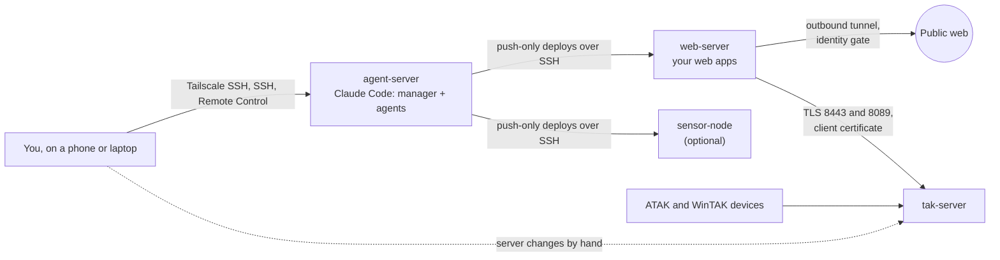

# What runs here, and why

[Back to the README](../README.md). The setup this guide was written from,
for anyone who wants to go past one machine. You do not need any of it to
use the practices in the README.

It is ten Claude Code agents on a headless Linux box, driven from a phone
or laptop: a manager that reviews and routes every request, eight domain
agents, and a cheaper builder that writes code to a settled design.
Bracken Systems builds drone mission-planning and flight-log tools,
airframes and RF sensing, with TAK integration, which is why the domain
agents cover ArduPilot, RF and TAK; yours will cover your own work. The
rule set and agent files in [`setup/`](../setup/) are the live ones.

## The machines

- **agent-server.** One headless box holds the repo, Claude Code and every
  agent. You talk to it from a phone or laptop. Nothing reaches into it
  except you.
- **web-server.** Your apps listen on localhost and are published through
  an outbound tunnel with an identity gate in front. The agents deploy to
  it by pushing over SSH; it holds no key back.
- **tak-server.** Receives data packages and Cursor on Target from the web
  server, authenticated by a client certificate. The agent server has no
  network path to it; changes there are made by you, from steps an agent
  writes. The web server does have a path and holds the certificate, so
  what keeps an agent off TAK through the web server is a rule, not the
  network.
- **sensor-node.** Optional. Any field box the agents deploy to the same
  way as the web server.

Every machine sits on one Tailscale network with tag-based access rules,
and those rules, not the agents' good behaviour, decide what can reach
what.

## Why this shape

- **One box for the agents, reached only by you.** You reach it through
  Remote Control, Tailscale SSH, or sshd with a key; off the LAN, SSH is
  reachable only over Tailscale. Rebuilding it costs an afternoon, so it
  stays disposable: its config is captured into git and its disk is
  imaged ([the agent server](agent-server.md)).
- **Deploys push one way.** A target holds no key back, so a compromised
  public machine cannot log in to the agent server, and no tailnet grant
  lets it connect.
- **The network decides reach.** An instruction can be ignored; a grant
  that does not exist cannot. Where the network leaves a path open (the
  web server to TAK), [the README's table](../README.md#the-rules-and-what-enforces-them)
  says the rule is all that holds it.
- **People make the changes agents are kept from.** The agent server has
  no network path to the TAK server, so TAK users and certificates are
  changed by hand, from steps an agent writes. The web server the agents
  deploy to with sudo holds the tunnel config and the account
  certificate, which can create, delete and manage all of the account's
  tunnels (Cloudflare, Tunnel permissions, read 2026-10-17), so only the
  stop rule keeps tunnel changes a human job. Cloudflare Access
  applications are changed in the dashboard.
- **A domain agent per area that keeps coming back.** Each of the eight
  covers an area with its own tools and traps, so a new session does not
  re-learn them. Design, deploys and live hardware stay with them; code to
  a settled design goes to the builder.

## The agents

| Agent | Model | Software it works with | Used for |
|---|---|---|---|
| `manager` | the session's model | Claude Code's agent and worktree tools | The front door: reviews each request, routes it to the agent that fits, or does a few minutes' work itself |
| `builder` | Sonnet, cannot spawn agents | whatever the brief names: Python, JavaScript, shell, the project's tests | Code to a settled design, one deliverable per brief, inside a fixed list of files |
| `stl-creator` | Opus | OpenSCAD, CadQuery, `xvfb-run` for PNG previews | Making STL files: a description, photo or measurements in, a parametric model, STL and preview out |
| `airframe` | Opus | manufacturer thrust tables, weight and endurance budgets | Choosing frames, motors, props and packs; thrust margin and hover time; reading a first hover log |
| `ardupilot-programmer` | Opus | ArduPilot, Lua scripting, SITL, MAVProxy and MAVLink, ExpressLRS | Anything that runs on or talks to a flight controller: parameter sets, upgrade diffs, onboard scripts |
| `rf-sensing` | Opus | HackRF (`hackrf_sweep`, receive only), the sensor's own service and page | Receive-only RF detection and direction finding on a sensor node |
| `tak-sme` | Opus | TAK Server, Cursor on Target, data packages, ATAK and WinTAK | Server users and certificates, what any feed sends, anything that must show on a device |
| `web-apps` | Opus | FastAPI, Pyodide, Playwright browser checks | Building and deploying the web apps (here, a mission planner and a flight log analyser) |
| `box-keeper` | Opus | Ubuntu, systemd, tmux, sshd, Tailscale, LVM, Clonezilla | The Linux machines at the OS level: services, access, updates, backups, config captures |
| `promo` | Opus | Playwright recording, ffmpeg, SITL flights | Clips, stills and caption cards for the apps; it never posts |

`manager` and `builder` are general, and [`starter/`](../starter/) has
trimmed copies of both. The other eight are this setup's domains: replace
them with your own.

## Using the live set

To start from `setup/` instead of `starter/`:

1. **Copy the rule set.** Put `setup/CLAUDE.md` at your repo root and
   `setup/.claude/` at `.claude/`. Claude Code reads `CLAUDE.md` in every
   session and the files in `.claude/agents/` as the agents you can spawn.
2. **Rewrite `CLAUDE.md` for your machine.** Keep its sections: what the
   machine is, where things live and which file to read for what,
   worktrees, scope, delegating, deliverables, when to act and when to
   stop, pushing. Replace the specifics, and keep it short.
3. **Keep `manager.md` and `builder.md`; rewrite the domain agents**, as
   the README's [On one machine](../README.md#on-one-machine) describes.
   Replace the owner's name and cut the worked examples (the
   direction-finding builds, the strap channel, Postflight's fixtures);
   they are this setup's.

## Names in setup/

The `setup/` and `tools/` files are copied unedited from the live repo at
each publish (edit them there, not here), so they use its real names. In
this guide:

| In `setup/` | In this guide |
|---|---|
| `brackenclaudebox`, `~/bracken` | `agent-server`, your repo root |
| `brackenwebserver`, `ssh webhost` | `web-server` |
| `brackentakserver` | `tak-server` |
| `brackensensor1` | `sensor-node` |
| `BRACKENCLAUDEBOX.md` | the machine record ([skeleton](../examples/machine-record.md)) |
| `tools/README.md` | the tool index ([skeleton](../examples/tools-README.md)) |
| `work/<project>/<part>/README.md` | a part's README ([skeleton](../examples/part-README.md)) |
| Preflight, Postflight | the two web apps: a mission planner and a flight log analyser |

They also reference files that are not published (each project's README,
the tool index, the machine record); the skeletons show their shape.

## The full build

| Doc | Covers |
|---|---|
| [The agent server](agent-server.md) | Ubuntu on LVM, Remote Control at boot, config capture, imaging, what broke |
| [Software on the agent server](software.md) | what each agent uses, where it came from, and what stays off a headless box |
| [Network and access](network.md) | Tailscale grants, one-way SSH deploy keys |
| [The web server](web-server.md) | loopback apps behind Cloudflare Tunnel and Access, ufw, deploy by push, the stop rule |
| [TAK Server integration](tak-integration.md) | mission packages and CoT to a TAK Server over mutual TLS, failing closed, testing without a server |
| [Incidents](incidents.md) | sixteen failures in six weeks, how each was caught, and the rule it produced, if any |
