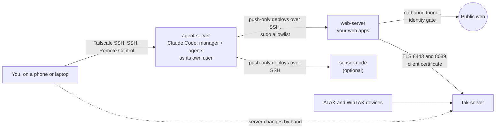

# What runs here, and why

[Back to the README](../README.md). The setup this guide was written from,
in broad strokes, for anyone who wants to go past one machine. You do not
need any of it to use the practices in the README. Apart from the two
scripts in [`tools/`](../tools/), none of the files described here are
published: the agent files and the other tools carry host names, project
detail and the names of people the work is for. The installable set is
[`starter/`](../starter/).

It is Claude Code on a headless Linux box, driven from a phone or laptop,
running as a Unix user of its own: a manager that reviews and routes every
request, a cheaper builder that writes code to a settled design, a
read-only reviewer, and a domain agent for each area of work that kept
coming back. Bracken Systems builds drone mission-planning and flight-log
tools, airframes and RF sensing, with TAK integration, which is why the
domain agents cover ArduPilot, Betaflight, RF and TAK; yours will cover
your own work.

## The machines

- **agent-server.** One headless box holds the repo, Claude Code and every
  agent, under a locked account with a sudo allowlist
  ([the agent as its own user](agent-account.md)). You talk to it from a
  phone or laptop. Nothing reaches into it except you.
- **web-server.** Your apps listen on localhost and are published through
  an outbound tunnel with an identity gate in front. The agents deploy to
  it by pushing over SSH as a locked account whose sudo is an allowlist of
  the deploy's exact commands; it holds no key back.
- **tak-server.** Receives data packages and Cursor on Target from the web
  server, authenticated by a client certificate. The agent server has no
  network path to it; changes there are made by you, from steps an agent
  writes. The web server does have a path and holds the certificate, so
  what keeps an agent off TAK through the web server is a rule, not the
  network.
- **sensor-node.** Optional. Any field box the agents deploy to the same
  way as the web server.

Every machine sits on one Tailscale network with tag-based access rules,
and those rules, not the agents' good behaviour, decide what can reach
what.

## Why this shape

- **One box for the agents, reached only by you.** You reach it through
  Remote Control, Tailscale SSH, or sshd with a key; off the LAN, SSH is
  reachable only over Tailscale, and ufw drops the rest. Rebuilding it
  costs an afternoon, so it stays disposable: its config is captured into
  git and its disk is imaged ([the agent server](agent-server.md)).
- **The agent is not you.** It has its own Unix account, its own
  credentials and a short list of what it may run as root. Your keys, your
  shell and your sudo are out of its reach by file permissions, not by
  instruction ([the agent as its own user](agent-account.md)).
- **Deploys push one way.** A target holds no key back, so a compromised
  public machine cannot log in to the agent server, and no tailnet grant
  lets it connect.
- **The network decides reach.** An instruction can be ignored; a grant
  that does not exist cannot. Where the network leaves a path open (the
  web server to TAK), [the README's table](../README.md#the-rules-and-what-enforces-them)
  says the rule is all that holds it.
- **People make the changes agents are kept from.** TAK users and
  certificates, the tunnel and its identity gate, sshd, Tailscale,
  sudoers, the firewall, and anything that makes something public.
- **A domain agent per area that keeps coming back.** Each covers an area
  with its own tools and traps, so a new session does not re-learn them.
  Design, deploys and live hardware stay with them; code to a settled
  design goes to the builder.

## The agents

Thirteen. Three are general, and `starter/` carries trimmed copies of all
three; the rest are this setup's domains, listed so you can see the grain
at which a domain gets an agent.

| Agent | Model | Area |
|---|---|---|
| `manager` | the session's | The front door: reviews each request, routes it to the agent that fits, or does a few minutes' work itself |
| `builder` | Sonnet, cannot spawn agents | Code to a settled design, one deliverable per brief, inside a fixed list of files |
| `reviewer` | Opus, cannot edit or spawn | Read-only review by an agent with none of the drafting context: public prose, rule changes, check scripts against their threat model; and read-only audits of a repo's history, a host's record or a run of session transcripts against a stated rule, with every count coming from a command the report quotes |
| `box-keeper` | Opus | The Linux machines at the OS level: services, access, updates, backups, config captures; owns the machine record |
| `web-apps` | Opus | The two web apps and the engines under them, their browser checks, and deploying them |
| `ardupilot-programmer` | Opus | Anything that runs on or talks to an ArduPilot flight controller: scripts, parameters, SITL, radio firmware |
| `betaflight` | Opus | The same for Betaflight boards: CLI backups, settings diffs, Blackbox logs, upstream pull requests |
| `airframe` | Opus | Frames, motors, props and packs; weight and thrust budgets; reading a first hover log |
| `rf-sensing` | Opus | Receive-only RF detection and direction finding on a sensor node, and any claim about what it heard |
| `tak-sme` | Opus | TAK Server users and certificates, what any feed sends, anything that must show on a device |
| `stl-creator` | Opus | Printable parts: a description, photo or measurements in, a parametric model, STL and preview out |
| `brand` | Opus | The business's public face: the website and its publish path, the design system the apps share, and promo clips and stills; it never posts, and deploys the site only on the owner's word |
| `client-docs` | Opus | Documents that go to one named reader, built as PDF with previews; it never sends anything |

Two were created after an independent review found their areas without
an owner; one of them, `remote-usb`, was retired on 2026-11-01, when the
owner judged that its app worked as wanted and the area no longer
recurred enough to carry a file; its lessons moved into the part's README. An agent goes when
its area stops recurring, as one does when it starts. Each domain agent file is short: where it points
at the record for its area, what the builder may not have, and nothing a
README already says.

## The tools

About eighty scripts, each with a row in a tool index that says how to
invoke it, and a `docs/` folder for the install notes too long for a row.
By kind:

- **Flight controllers.** Parameter dumps and writes over MAVFTP pinned to
  one board and read back; firmware version and parameter-metadata diffs
  between trees; SITL launched from a version-matched tree and
  smoke-tested by flying it; log format diffs; a headless Betaflight CLI
  with backups tested against SITL first.
- **Deploys.** One script per service per host, pushing over SSH, running
  the service's selftest on the target, allowlisted command by command in
  the target's sudoers.
- **Captures.** One per host, pulling the hand-made config files into git;
  each with a list of what it never captures.
- **Checks.** The repo's own rules checked by script; the agent-file
  permission rule exercised after each Claude Code update; the public
  scan before anything leaves; a visibility check that prints `public`,
  `private` or `ask`; a read-only fleet status row per host; a link
  checker for the public guide.
- **Backups.** A nightly encrypted pull of the web server's data; a
  secrets archive the owner takes by hand; a pre-image checklist that
  names every credential-bearing file.
- **Publishing.** The snapshot publish of this guide with its gates
  ([the GitHub side](github-repo.md)), and a second gate for a public
  fork of an upstream project.
- **Documents and media.** PDF builders in the design system, an HTML to
  PDF renderer with PNG previews, real-browser checks under Playwright,
  the promo captures.
- **Third-party trees**, pinned by tag or commit and gitignored: ArduPilot
  with a worktree per firmware version the fleet runs, Betaflight,
  ExpressLRS, mLRS, blackbox-tools, gitleaks, lychee.

## Under evaluation

- **Cloudflare's security-audit skill**
  ([cloudflare/security-audit-skill](https://github.com/cloudflare/security-audit-skill),
  MIT, commit `c1c8a8c`, read 2026-11-01). A method for a parent agent:
  it spawns reconnaissance, hunter, verifier and critic agents over a
  source tree and keeps a coverage ledger that a script validates. One
  `quick` pass on one of the two web apps, reading source only, covered
  14 of 29 units and deferred 6. It found six leads that the app's
  selftests and two earlier reviews had missed. None was confirmed by
  running code; each held on a read of the source, and all six were fixed
  and deployed on 2026-11-02. It looked beneficial, and it stayed in
  use: the sandboxed runs since confirm findings by running code.
- **How it runs here.** The manager is the parent, in a fresh session,
  because only the manager spawns agents other than the builder. The
  first pass ran every agent on the session's model and spent more than
  1.6 M tokens; the second, on 2026-11-02, ran the hunters and verifiers
  on Sonnet from written briefs. The skill is installed for the run and removed
  after: its description matches any security question, so a standing
  install would change every agent's security answers. The `reviewer`
  read it before the first run, and reads any bump of the pinned commit.
  Without an OS sandbox nothing of the target runs, and every lead stays
  unconfirmed. The sandbox went live on 2026-11-02, once the owner
  installed the distribution's AppArmor profile for bwrap; target code
  runs only after its selfcheck proves each of its 20 controls.
- **It audited its own tooling.** A `quick` run on 2026-11-04 over the
  sandbox and the run script found the containment boundary sound and
  four low defects in the steps that set up and land a run: among them,
  the content check reported ok when its search errored or skipped a
  symlink or binary file. All four were fixed with an offline test, and
  landing a run now refuses, copying nothing, if the check has any FAIL
  (2026-11-05).

## The full build

| Doc | Covers |
|---|---|
| [The agent server](agent-server.md) | Ubuntu on LVM, Remote Control at boot, config capture, imaging, what broke |
| [The agent as its own user](agent-account.md) | the locked account, the sudo allowlist, moving an existing install |
| [The GitHub side](github-repo.md) | the private repo, the agent's token, rulesets and protection on a public repo, snapshot publishing |
| [Software on the agent server](software.md) | what each agent uses, where it came from, and what stays off a headless box |
| [Network and access](network.md) | Tailscale grants, one-way SSH deploy keys |
| [The web server](web-server.md) | loopback apps behind Cloudflare Tunnel and Access, ufw, deploy by push under a sudo allowlist, the stop rule |
| [TAK Server integration](tak-integration.md) | mission packages and CoT to a TAK Server over mutual TLS, failing closed, testing without a server |
| [Incidents](incidents.md) | what went wrong, how each was caught, and the rule it produced, if any |
